# ENTITY RELATIONSHIP DIAGRAM (ERD)

**Document:** `docs/architecture/erd-diagram.md`  
**Phase:** Phase 1 (Architecture & Foundation)  
**Status:** Complete  
**Date:** November 2026  

---

## 1. Domain Model Overview

```mermaid
erDiagram
    USER ||--o{ SESSION : has
    USER ||--o{ ADDRESS : saves
    USER ||--o{ ORDER : places
    USER ||--o| CART : owns
    USER ||--o| WISHLIST : maintains
    USER ||--o{ ENTITLEMENT : holds
    USER ||--o{ READING_PROGRESS : tracks
    USER ||--o{ REVIEW : writes
    USER ||--o{ AUDIT_LOG : triggers

    PUBLISHER ||--o{ BOOK : publishes
    SERIES ||--o{ BOOK : groups
    BOOK ||--|{ BOOK_EDITION : has_variants
    BOOK ||--o{ BOOK_AUTHOR : written_by
    AUTHOR ||--o{ BOOK_AUTHOR : writes
    BOOK ||--o{ BOOK_CATEGORY : categorized_under
    CATEGORY ||--o{ BOOK_CATEGORY : contains
    CATEGORY ||--o{ CATEGORY : parent_of
    BOOK ||--o{ BOOK_ASSET : holds_files
    BOOK ||--o| SAMPLE_CONFIG : configures_preview
    BOOK ||--o{ ENTITLEMENT : unlocks_access

    BOOK_EDITION ||--o{ CART_ITEM : in_cart
    BOOK_EDITION ||--o{ ORDER_ITEM : ordered_in
    BOOK_EDITION ||--o{ INVENTORY_MOVEMENT : tracks_stock

    CART ||--o{ CART_ITEM : contains
    ORDER ||--|{ ORDER_ITEM : contains
    ORDER ||--o{ ORDER_STATUS_HISTORY : logs_states
    ORDER ||--o{ PAYMENT : records
    ORDER ||--o{ SHIPMENT : fulfills
    ORDER ||--o| COUPON : applies
    PAYMENT ||--o{ REFUND : processes

    SHIPPING_ZONE ||--|{ SHIPPING_RATE : defines_fees

    USER {
        string id PK
        string email UK
        string phoneNumber UK
        string role "SUPER_ADMIN | EDITOR | CUSTOMER"
        boolean twoFactorEnabled
    }

    BOOK {
        string id PK
        string titleSi
        string titleEn
        string transliterated "Phonetic Singlish"
        string slug UK
        string language "SINHALA | ENGLISH | TAMIL"
        boolean isFeatured
        boolean isBestSeller
    }

    BOOK_EDITION {
        string id PK
        string bookId FK
        string format "PAPERBACK | HARDCOVER | EBOOK | BUNDLE"
        string isbn UK
        string sku UK
        int priceCents "Integer Cents LKR"
        int stockQuantity
        boolean isDigital
    }

    SAMPLE_CONFIG {
        string id PK
        string bookId FK
        string sampleType "PAGE_RANGE | PERCENTAGE | CHAPTERS"
        int maxPages
        int percentageLimit
        string sampleFileUrl
    }

    ENTITLEMENT {
        string id PK
        string userId FK
        string bookId FK
        datetime grantedAt
        boolean isActive
    }

    ORDER {
        string id PK
        string orderNumber UK
        string status "PENDING_PAYMENT | PAID | SHIPPED"
        int subtotalCents
        int totalCents
        string paymentMethod "PAYHERE | BANK_TRANSFER | COD | KOKO"
    }

    PAYMENT {
        string id PK
        string orderId FK
        int amountCents
        string status "PENDING | SUCCESS | FAILED"
        string transactionRef
        string slipImageUrl
        string slipVerifiedBy
    }

    AUDIT_LOG {
        string id PK
        string userId FK
        string action
        string resource
        string beforeData
        string afterData
        datetime createdAt
    }
```

