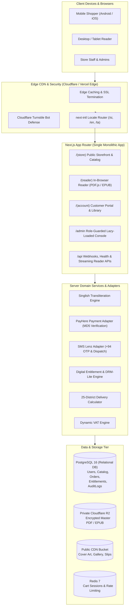
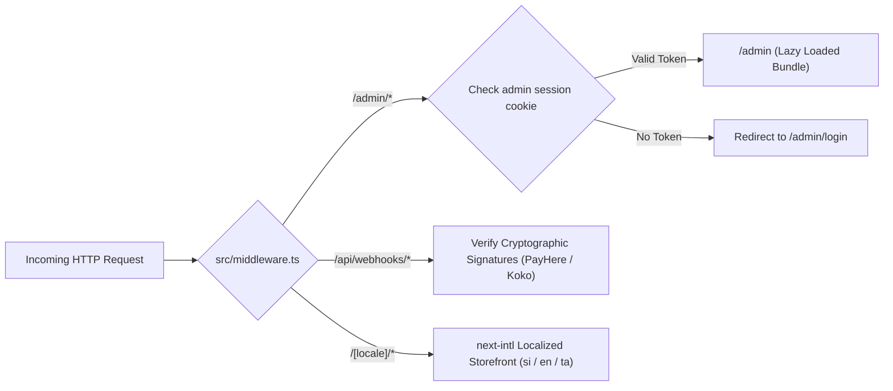

# SYSTEM ARCHITECTURE: Padanama Publications

**Document:** `docs/architecture/system-architecture.md`  
**Phase:** Phase 1 (Architecture & Foundation)  
**Status:** Complete  
**Date:** November 2026  

---

## 1. High-Level Architecture Diagram

---

## 2. Security Boundaries & Route Segregation

