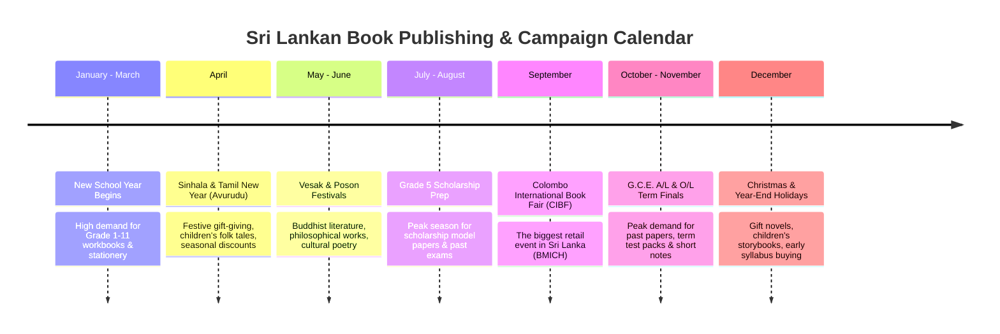

# LOCAL CONTEXT: PAYMENTS, COURIERS, TAX, LAW & TYPOGRAPHY

**Document:** `docs/research/local-context.md`  
**Phase:** Phase 0 (Discovery & Research)  
**Status:** Complete  
**Date:** November 2026  

---

## 1. The Sri Lankan Book Fair Season & Cultural Campaign Calendar

In Sri Lanka, book buying is deeply intertwined with cultural festivals, national award seasons, and the academic school calendar:



### 1.1. The Colombo International Book Fair (CIBF)
* **Venue & Scale:** Held annually for 10 days in mid-to-late September at the BMICH (Bandaranaike Memorial International Conference Hall) in Colombo. Organised by the Sri Lanka Book Publishers’ Association (SLBPA), it draws over **1,000,000 visitors**.
* **Retail Impact:** Publishers routinely generate **25–40% of their annual retail turnover** during this 10-day period. Standard practice is to offer a universal **20% discount** on all titles, alongside exclusive book launches and author signings.
* **Online Opportunity:** Millions of readers living in distant provinces (Jaffna, Matara, Badulla, Anuradhapura) cannot travel to BMICH. Competitors struggle with web server crashes during September.
* **Platform Requirement: "Book Fair Mode" (පොත් ප්‍රදර්ශන සමය):**
  - Admin toggle to activate Book Fair Mode site-wide.
  - Custom festive banner with countdown timer to the fair's opening/closing.
  - Automated promotional rule applying the 20% discount across eligible categories.
  - High-concurrency edge caching enabled to handle sudden 10x traffic spikes.
  - "Book Fair Exclusive Bundles" and virtual author meet-and-greet announcements.

---

## 2. Sinhala & Tamil Web Typography & Singlish Transliteration

Sri Lanka's digital demographic interacts in three languages: Sinhala (සිංහල), Tamil (தமிழ்), and English. Displaying complex Indic scripts on the web presents distinct typographic and technical challenges.

### 2.1. Font Selection & Pairing Hierarchy

| Role | Sinhala Font | Tamil Font | Latin / English Pairing | Design Intent |
|---|---|---|---|---|
| **Display / Headings** | **Gemunu Libre** or **Yaldevi** | **Mukta Malar** (Bold) | **Fraunces** or **Playfair Display** | Celebratory, editorial, cultural dignity, clean stroke contrast |
| **Body / Long-Form** | **Noto Serif Sinhala** or **Abhaya Libre** | **Noto Serif Tamil** | **Merriweather** or **Lora** | High legibility for long-form book synopses, reviews, and reader text |
| **UI Elements & Buttons** | **Noto Sans Sinhala** | **Noto Sans Tamil** | **Inter** or **Plus Jakarta Sans** | Crisp rendering at small pixel sizes (12px–14px) on low-DPI screens |

### 2.2. Preventing Diacritic Clipping (*Ispili* & *Papili*)
Sinhala is an abugida script where vowels are attached as diacritic modifiers (*පිල්ල*) above, below, before, or after the base consonant:
* Upper diacritics: *Ispilla* (ි), *Diga Ispilla* (ී) extend above the consonant ascender line.
* Lower diacritics: *Papilla* (ු), *Diga Papilla* (ූ), *Gaetapilla* (ෘ) extend deep below the baseline.
* Combined glyphs: *Bandi Akuru* (e.g. ඤ, ඥ, ඣ, ඦ) create tall vertical bounding boxes.

> [!CAUTION]
> **Typography Hard Rule:** Default CSS `line-height: 1.2` or `1.4` will violently truncate Sinhala diacritics in buttons, headers, and reader views.
> **Mandatory Rule:** All Sinhala and Tamil typography must be set with **`line-height >= 1.7`** (or minimum `1.65` in compact tables), accompanied by generous vertical padding (`py-2` minimum on buttons). Self-hosted WOFF2 web fonts must include full Unicode blocks `U+0D80..U+0DFF` (Sinhala) and `U+0B80..U+0BFF` (Tamil).

### 2.3. Singlish to Sinhala Transliteration Search Engine
Over **70% of mobile users in Sri Lanka** type in Latin phonetic script ("Singlish") rather than switching to a Sinhala Unicode keyboard. If a user types `madol duwa`, `ganithaya`, or `sinhabahu`, an ordinary database query returns **zero results**.

The Padanama platform must incorporate an instant phonetic transliteration algorithm:

```
[User Input Query: "guru geethaya"]
              │
              ▼
[Transliteration Pre-Processor]
   - Detects Latin character input
   - Applies Phonetic Grammar & Syllable Rules:
       "gu"  -> "ගු"
       "ru"  -> "රු"
       "gee" -> "ගී"
       "tha" -> "ත"
       "ya"  -> "ය"
   - Output Sinhala Candidate: "ගුරු ගීතය"
              │
              ▼
[Hybrid Search Query]
   - Match 1: Native Sinhala title ("ගුරු ගීතය")
   - Match 2: Transliterated keyword ("guru geethaya")
   - Match 3: Author name ("චිංගීස් අයිත්මාතව්" / "Chinghiz Aitmatov")
   - Match 4: Trigram fuzzy similarity (tolerance for typos)
              │
              ▼
[Returns Instant Results within <150ms]
```

---

## 3. Sri Lankan Payment Ecosystem & Gateway Integration

Sri Lanka operates under unique payment dynamics: Stripe does not support merchant payouts to Sri Lankan bank accounts. E-commerce depends on domestic fintech aggregators, BNPL players, direct bank transfers, and Cash on Delivery.

### 3.1. Gateway Comparison

| Gateway / Method | Transaction Fee | Supported Channels | Settlement Cycle | Webhook / Notify Verification | Notes |
|---|---|---|---|---|---|
| **PayHere** | ~2.49% – 2.99% + LKR 10–30 | Visa, Mastercard, Amex, eZ Cash, mCash, Genie, FriMi, Internet Banking | Weekly (T+3) | **MD5 Signature Hash (`md5sig`)** | Market leader, Central Bank approved, robust sandbox |
| **WebXPay** | ~2.5% – 3.0% + monthly fee | Visa, Mastercard, LankaQR, Sampath Vishwa | Weekly | RSA/SHA256 callback signature | Secondary/backup payment gateway |
| **KOKO (BNPL)** | ~4.5% – 6.0% (merchant borne) | 3-month split payments (debit/credit card) | Weekly | API Webhook callback | Highly effective for high-value orders & book sets |
| **Mintpay (BNPL)** | ~4.5% – 5.5% (merchant borne) | 3-month split payments (debit/credit card) | Weekly | API Webhook callback | Popular among Gen-Z and urban readers |
| **Bank Transfer / Slip** | 0% (free bank-to-bank) | Direct transfer / CDM deposit to BOC, Sampath, Commercial | Immediate funds in account | **Manual In-App Admin Verification** | 30%+ of domestic online book orders; requires slip image upload |
| **Cash on Delivery (COD)** | Courier fee + 2%–3% collection surcharge | Cash paid to courier upon doorstep delivery | Weekly from courier company | Courier API status callback / Manual | Highest customer trust; risk of refusal / RTO |

### 3.2. PayHere Implementation Specifications

#### Request Hash (Checkout Initiation):
When rendering the PayHere payment form, the server must compute an MD5 hash using the merchant secret:
$$\text{hash} = \text{strtoupper}\left(\text{md5}\left(\text{merchant\_id} + \text{order\_id} + \text{amount\_formatted} + \text{currency} + \text{strtoupper}\left(\text{md5}(\text{merchant\_secret})\right)\right)\right)$$
*Where `amount_formatted` is formatted strictly to 2 decimal places (e.g. `1250.00`).*

#### Webhook Notification (`notify_url`) Verification:
When PayHere completes the transaction, its servers POST a payload to `https://padanama.lk/api/webhooks/payhere`. The application must verify:
$$\text{calculated\_md5} = \text{strtoupper}\left(\text{md5}\left(\text{merchant\_id} + \text{order\_id} + \text{payhere\_amount} + \text{payhere\_currency} + \text{status\_code} + \text{strtoupper}\left(\text{md5}(\text{merchant\_secret})\right)\right)\right)$$
*Security Protocol:*
1. Reject immediately if `calculated_md5 !== payload.md5sig`.
2. Reject if `payload.status_code != 2` (only status `2` signifies success).
3. Validate that `payload.payhere_amount` matches the exact order total stored in the database.
4. Log payload in an idempotent `PaymentEvent` table to prevent replay attacks.
5. Never grant order fulfillment or digital entitlements based on the client browser redirect (`return_url`).

### 3.3. Bank Slip Upload & Verification Workflow
1. Customer selects **Bank Deposit / Fund Transfer** at checkout.
2. Order is created in state `PENDING_SLIP_VERIFICATION`.
3. Screen displays Padanama's corporate bank accounts:
   - Bank of Ceylon (BOC) — Borella Branch — Acc: `[SAMPLE]` 0081294812
   - Sampath Bank — Kolonnawa Branch — Acc: `[SAMPLE]` 101829401928
   - Commercial Bank — Gothatuwa Branch — Acc: `[SAMPLE]` 8001928471
4. Customer uploads a photo/screenshot of the bank receipt or online banking transfer slip.
5. System attaches image to the order and sends customer an instant confirmation SMS: *"We received your payment slip for order PDN-XXXX. We will verify and process your books shortly."*
6. Admin attention tray flags the pending slip. Staff clicks **"Approve"**, advancing state to `PAID`, releasing inventory, and initiating packing.
7. Orders without an uploaded slip within 48 hours receive an automated SMS reminder; if no slip is uploaded after 72 hours, reserved stock is automatically returned to inventory.

---

## 4. Logistics, Couriers & District Delivery Across Sri Lanka

Sri Lanka is divided administratively into **9 Provinces** and **25 Districts**. E-commerce delivery speed and freight rates vary significantly between Colombo metropolitan zones, outstation provincial capitals, and rural/remote regions.

### 4.1. The 25-District Delivery Zone Matrix

```mermaid
graph TD
    subgraph Zone 1: Colombo Metro (1-2 Days)
        Z1_Col[Colombo]
    end
    subgraph Zone 2: Greater Western & Suburbs (2-3 Days)
        Z2_Gam[Gampaha]
        Z2_Kal[Kalutara]
    end
    subgraph Zone 3: Major Provincial Capitals (2-4 Days)
        Z3_Kan[Kandy]
        Z3_Gal[Galle]
        Z3_Mat[Matara]
        Z3_Kur[Kurunegala]
        Z3_Rat[Ratnapura]
        Z3_Keg[Kegalle]
    end
    subgraph Zone 4: Outstation & Distant Districts (3-5 Days)
        Z4_Anu[Anuradhapura]
        Z4_Pol[Polonnaruwa]
        Z4_Jaf[Jaffna]
        Z4_Kil[Kilinochchi]
        Z4_Man[Mannar]
        Z4_Vav[Vavuniya]
        Z4_Mul[Mullaitivu]
        Z4_Tri[Trincomalee]
        Z4_Bat[Batticaloa]
        Z4_Amp[Ampara]
        Z4_Bad[Badulla]
        Z4_Mon[Monaragala]
        Z4_Ham[Hambantota]
        Z4_Mat2[Matale]
        Z4_Nuw[Nuwara Eliya]
        Z4_Put[Puttalam]
    end
```

### 4.2. Courier Partner Landscape
1. **Domex Logistics:** Largest domestic private courier network with 100+ branches. Highly reliable for islandwide COD collections. Typical rates: LKR 200–250 (1st kg Colombo), LKR 300–400 (outstations). Provides merchant API for airway bill generation and tracking status webhooks.
2. **Koombiyo Delivery:** Rapidly growing, volume-driven e-commerce courier offering low entry rates (LKR 150–200 Colombo, LKR 250 outstations). Popular for social media merchants, weekly COD remittance cycle.
3. **Pronto Lanka:** Established courier service with strong institutional and government delivery presence.
4. **Sri Lanka Post (Speed Post / EMS):** Inexpensive reach covering the most remote rural postal zones; ideal fallback when private couriers lack coverage.
5. **DHL Express:** Standard international courier for overseas diaspora shipments (UK, Australia, US, UAE, Canada).

---

## 5. Sri Lankan Tax Regulations: Value Added Tax (VAT)

The taxation of books in Sri Lanka has witnessed significant legal oscillation over recent budget cycles:

* **Historical Status:** Books and educational materials were historically exempt from VAT under Section 3 of the Value Added Tax Act No. 14 of 2002.
* **The 2024–2025 18% Shock:** Under the **Value Added Tax (Amendment) Act No. 32 of 2023** (effective January 1, 2024), the standard VAT rate was raised to **18%**, and exemptions were eliminated for a broad array of goods, including printed books, educational periodicals, and exercise books. This caused public outcry over rising educational costs.
* **The 2026/2027 Reversal & Exemption:** In response to severe educational sector impact, late 2026 parliamentary budget announcements initiated amendments to restore **full VAT exemption** on printed books, exercise books, children's coloring books, and educational publications.

> [!IMPORTANT]
> **Tax Architecture Mandate:** Because Sri Lankan tax laws are subject to rapid fiscal policy shifts, tax rates **must never be hard-coded**.
> The platform must feature a dynamic **Tax Configuration Engine** in the Admin Panel:
> - Tax rules can be enabled or disabled globally.
> - Default rate configurable (e.g. 0% for exempt books, 18% for stationery/merchandise).
> - Category-specific tax overrides.
> - Invoices must dynamically format tax lines (`VAT 0%` or `VAT 18%`) in accordance with Inland Revenue Department (IRD) electronic invoicing guidelines.

---

## 6. Sri Lankan Legal & Regulatory Compliance

### 6.1. Personal Data Protection Act No. 9 of 2022 (PDPA)
The PDPA is Sri Lanka's equivalent to the EU GDPR, establishing the Data Protection Authority (DPA) of Sri Lanka and defining obligations for Data Controllers:
1. **Lawful Basis & Consent:** The platform must collect explicit consent for marketing, tracking cookies, and customer accounts.
2. **Trilingual Transparency:** Privacy policy and consent notices must be provided in Sinhala, Tamil, and English.
3. **Data Subject Rights:**
   - Right of Access: Customers can request an export of all their personal data in machine-readable JSON.
   - Right to Erasure / To Be Forgotten: Customers can request account deletion (anonymizing order history while retaining required tax transaction records).
4. **Security & Breach Notification:** Encrypted storage of customer data, password hashing via Argon2/bcrypt, secure session management, and notification runbooks.
5. **Cross-Border Transfers:** Cloud servers (Supabase/Neon/Vercel) located overseas must comply with PDPA international transfer safeguards.

### 6.2. Electronic Transactions Act No. 19 of 2006
* Validates electronic contracts, online orders, digital receipts, and electronic signatures.
* Establishes that digital terms & conditions accepted at checkout constitute a legally binding sales contract under Sri Lankan law.

### 6.3. Consumer Affairs Authority (CAA) Act No. 9 of 2003
* Demands transparent price declarations: the price displayed on the product page must clearly indicate whether shipping and taxes are included or calculated at checkout.
* Clear return, replacement, and refund policies must be published and accessible from every footer.

### 6.4. Intellectual Property Act No. 36 of 2003 (Copyright & Sample Limits)
* Protects the literary property of authors and publishers.
* Sections 11–13 govern reproduction rights and fair dealing exceptions.
* In the Digital Library, offering a **free sample preview (e.g., up to 20% or 2 chapters)** constitutes fair promotion under publisher author contracts. To protect full works from unauthorized reproduction, the system must enforce rigorous technical access controls (no raw PDF downloads, server-side page slicing, dynamic customer watermarks on purchased e-books).
