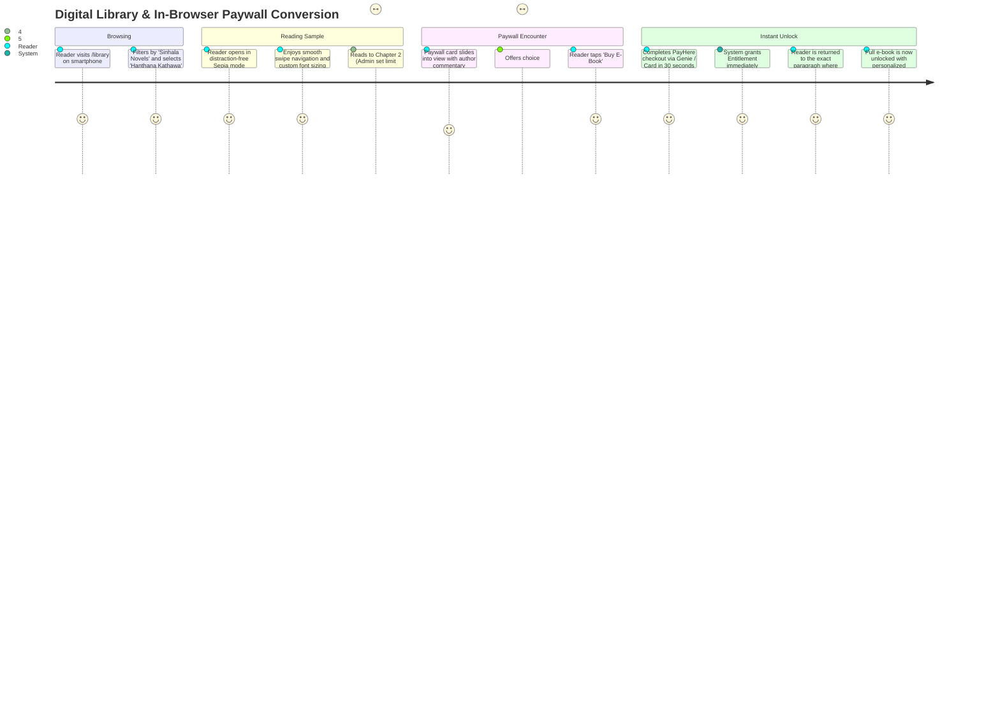

# PERSONAS AND USER JOURNEYS

**Document:** `docs/research/personas-and-journeys.md`  
**Phase:** Phase 0 (Discovery & Research)  
**Status:** Complete  
**Date:** November 2026  

---

## 1. Primary Reader & Customer Personas

### Persona 1: Dilrukshi (The Conscientious Parent)
* **Demographics:** Age 36, Mother of two (Grade 5 Scholarship student & Grade 2 child), living in Gampaha.
* **Tech Profile:** Uses an Android smartphone (Samsung Galaxy A-series) on Dialog 4G; heavy WhatsApp and Facebook user; reluctant to enter credit card details on unfamiliar websites; prefers Cash on Delivery (COD) or Bank Transfer via Commercial Bank app.
* **Goals:**
  - Find top-rated Grade 5 Scholarship workbooks (*ශිෂ්‍යත්ව පෙරහුරු ප්‍රශ්න පත්‍ර*) and activity books for her children.
  - Review the difficulty level and contents of the questions before purchasing.
  - Receive the books quickly before term evaluation exams begin.
* **Pain Points:**
  - Local bookshops are often out of stock of specific term assessment papers.
  - Ordering via WhatsApp is slow; she has to wait hours for prices and bank details.
  - Hard to tell if a workbook has high-quality, authentic syllabus-aligned questions without flipping through it.
* **Platform Touchpoints:**
  - Reads a 15-page free sample of a Scholarship workbook in the in-browser reader on her phone.
  - Adds the Grade 5 bundle to cart, chooses Cash on Delivery (COD), verifies with a 4-digit SMS OTP, and receives instant Domex tracking.

---

### Persona 2: Chamath (The Exam Candidate / G.C.E. O/L & A/L Student)
* **Demographics:** Age 17, Grade 11 student preparing for G.C.E. O/L exams, living in Kandy.
* **Tech Profile:** Highly mobile-savvy; types primarily in "Singlish" on mobile keyboard ("ganithaya short notes", "science past papers"); uses eZ Cash or borrows mother's card.
* **Goals:**
  - Quickly find provincial past papers with step-by-step marking schemes.
  - Access revision summaries and short notes (*කෙටි සටහන්*) directly on his smartphone during commute.
* **Pain Points:**
  - Typing Sinhala Unicode on mobile is tedious; search bars on most Sri Lankan bookstore sites fail on Singlish terms.
  - Cannot afford to buy 10 physical past paper books at once; wants affordable digital revision notes or bundles.
* **Platform Touchpoints:**
  - Types "ganithaya 11 past papers" into instant search; gets instant matched suggestions.
  - Samples the first chapter in the digital reader; purchases the e-book version via eZ Cash for immediate reading.

---

### Persona 3: Kusal (The Literary & Fiction Enthusiast)
* **Demographics:** Age 28, Software Engineer living in Colombo; avid reader of contemporary Sinhala literature, Swarna Pusthaka award winners, and world translations.
* **Tech Profile:** iPhone user, comfortable with online card payments (Visa/Mastercard) and Koko BNPL; orders books late at night; values aesthetic design and typography.
* **Goals:**
  - Discover new releases by emerging Sri Lankan authors and acclaimed translations.
  - Sample the opening chapter of a novel to assess the writing style and font rendering.
  - Buy a collector's hardcover edition for his personal bookshelf.
* **Pain Points:**
  - Many bookstore sites display Sinhala fonts with ugly clipping or broken conjunct characters (*බැඳි අකුරු*).
  - Lack of trusted customer reviews and author background details.
* **Platform Touchpoints:**
  - Discovers author interview on Padanama Blog; reads the first 2 chapters in paper-textured reader mode; buys the hardcover with Koko 3-month installment.

---

### Persona 4: Nirasha (The Diaspora Reader & Gift Buyer)
* **Demographics:** Age 34, Sri Lankan living in Melbourne, Australia; mother of a 6-year-old whom she wants to teach Sinhala.
* **Tech Profile:** High-income, MacBook and iPad user, pays via international credit card (AUD/USD); values fast international DHL delivery or instant e-book access.
* **Goals:**
  - Purchase illustrated Sinhala children's books and folk tales (*හත්පන, මඟුල් කෑම*) for her child in Australia.
  - Order book care packages delivered to her parents in Kurunegala for birthdays and Avurudu.
* **Pain Points:**
  - Most Sri Lankan bookstores fail to accept international credit cards smoothly or charge exorbitant opaque shipping rates.
  - Lack of multi-currency price previews (wants to see prices in AUD/USD).
* **Platform Touchpoints:**
  - Views store in English/Sinhala with prices toggled to AUD; selects local delivery to her parents' address in Kurunegala; pays instantly via PayHere international card checkout.

---

### Persona 5: Rev. Vipulasara / Mrs. Jayawardena (School Librarian & Institutional Buyer)
* **Demographics:** Age 52, Head Librarian at a prominent National School in Galle.
* **Tech Profile:** Uses desktop PC in school library; relies on formal government purchase orders, invoices, and bank deposits.
* **Goals:**
  - Order 20–50 copies of supplementary reading books and reference dictionaries for the school library.
  - Request official quotations and pro-forma invoices with government tax registration details.
* **Pain Points:**
  - Standard consumer checkout does not support bulk volume discounts, formal institutional purchase orders, or delayed bank settlement.
* **Platform Touchpoints:**
  - Uses the "Wholesale & Institutional Enquiries" portal on Padanama to generate an instant formal quotation; coordinates bulk courier delivery.

---

### Persona 6: Bandara (Regional Bookshop Owner / Reseller)
* **Demographics:** Age 46, Owner of a retail stationery and bookstore in Anuradhapura.
* **Tech Profile:** Pragmatic trader; WhatsApp is his primary business tool; buys wholesale stock for school terms.
* **Goals:**
  - Order bulk consignments of Padanama workbooks at trade wholesale discounts (25–35% off retail).
  - Track replenishment shipments and access back-in-stock alerts.
* **Platform Touchpoints:**
  - Logs into verified Wholesale Account tier; places trade order with bulk packaging slip; arranges cargo bus or Domex bulk logistics.

---

## 2. Internal & External Operational Stakeholders

### Stakeholder 1: The Publisher / Business Owner (Mr. Karunaratne)
* **Role:** High-level strategic and financial direction.
* **Needs:** 
  - Executive dashboard showing daily, weekly, and monthly revenue trends.
  - Breakdown of physical vs. digital sales, best-selling titles, and gross margin by category.
  - Accurate author royalty tracking to ensure timely and transparent contract settlements.
  - Control over site-wide promotional campaigns, specifically "Book Fair Mode" for the September BMICH event.

### Stakeholder 2: The Catalog Editor / Content Manager
* **Role:** Managing book metadata, authors, genres, and cover assets.
* **Needs:**
  - Trilingual input fields (Sinhala, English, Tamil) for titles, synopses, and specs.
  - Drag-and-drop cover image uploader with automated WebP/AVIF compression.
  - Ability to group books into series, curriculum grade tags, and seasonal collections.

### Stakeholder 3: The Digital Librarian
* **Role:** Custodian of digital assets, sample configurations, and content security.
* **Needs:**
  - Secure PDF/EPUB upload module that automatically extracts server-side preview slices.
  - Interactive rule configurator to set free-sample limits (e.g., "Pages 1 to 24" or "First 2 Chapters") with a live reader preview showing where the paywall card appears.
  - Watermark configuration for purchased full e-books (buyer's email and order ID dynamically stamped onto pages).

### Stakeholder 4: The Fulfillment & Warehouse Officer
* **Role:** Picking, packing, and dispatching physical orders.
* **Needs:**
  - Clean order fulfillment queue filtered by status (`PAID`, `COD_CONFIRMED`).
  - One-click bulk printing of combined invoice, packing slip, and courier shipping label.
  - Barcode / tracking number scanner input to automatically mark orders as `SHIPPED` and dispatch customer SMS notifications.

### Stakeholder 5: The Finance Officer / Accountant
* **Role:** Payment verification, reconciliation, and tax compliance.
* **Needs:**
  - Dedicated **Bank Slip Verification Tray**: side-by-side view of customer order details and uploaded deposit slip image, with one-click "Approve" or "Reject (with reason)" buttons.
  - Automated reconciliation of PayHere merchant settlement payouts against order records.
  - Dynamic VAT calculation logs and monthly exportable tax reports.

---

## 3. End-to-End User Journey Maps

### Journey A: Dilrukshi Buys a Grade 5 Scholarship Workbook with Free Sample Preview

```mermaid
journey
    title Dilrukshi's Buying Journey (Free Sample to Cash on Delivery)
    section Discovery
      Sees Facebook post on Padanama page: 5: Dilrukshi
      Clicks link, lands on Mobile Book Detail page: 5: Dilrukshi
    section Evaluation & Preview
      Taps 'Read Free Sample' (නොමිලේ කියවන්න): 5: Dilrukshi
      Reader opens instantly without download: 5: Dilrukshi
      Flips through 15 pages of sample exam questions: 5: Dilrukshi
      Reaches paywall card at page 16: 4: Dilrukshi
    section Purchase & Checkout
      Taps 'Buy Paperback Rs. 650' on paywall card: 5: Dilrukshi
      Enters Gampaha address; selects Cash on Delivery (COD): 5: Dilrukshi
      Receives 4-digit SMS OTP on Dialog phone; enters to confirm: 5: Dilrukshi
      Order placed successfully (PDN-2026-00412): 5: Dilrukshi
    section Fulfillment & Receipt
      Receives SMS: 'Your order is packed': 5: Dilrukshi
      Domex rider delivers parcel in 2 days; Dilrukshi pays cash: 5: Dilrukshi
```

---

### Journey B: Bank Transfer with Deposit Slip Upload & Admin Verification

```mermaid
journey
    title Bank Transfer & Verification Journey
    section Customer Checkout
      Customer adds 3 novels to cart (Total: Rs. 3,450): 5: Customer
      Selects 'Bank Transfer / Deposit' at checkout: 5: Customer
      Views Padanama bank account details (BOC / Sampath / Commercial): 4: Customer
      Transfers money via Banking App; takes screenshot: 4: Customer
      Uploads slip image directly on order confirmation page: 5: Customer
    section Automated Ingestion
      System saves order as 'PENDING_SLIP_VERIFICATION': 5: System
      Sends customer SMS: 'Slip received, awaiting verification': 5: System
      Pushes order to Admin Attention Tray: 5: System
    section Admin Review
      Accountant opens Admin Dashboard: 5: Accountant
      Inspects slip image vs bank statement in side-by-side modal: 5: Accountant
      Clicks 'Verify & Approve': 5: Accountant
    section Order Execution
      Order advances to 'PAID / PROCESSING': 5: System
      Fulfillment staff receives packing ticket: 5: Store Staff
      Customer receives SMS: 'Payment verified! Packing your order': 5: Customer
```

---

### Journey C: Digital Reading & Seamless Paywall Conversion


