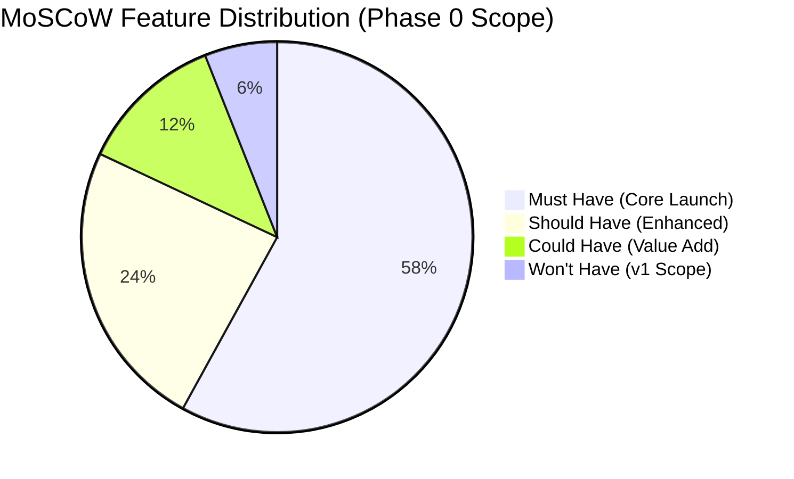

# REQUIREMENTS SPECIFICATION & MOSCOW PRIORITIZATION

**Document:** `docs/research/requirements.md`  
**Phase:** Phase 0 (Discovery & Research)  
**Status:** Complete  
**Date:** November 2026  

---

## 1. Functional Requirements (FR)

### 1.1. Catalog & Product Taxonomy
* **FR-1.1 (Hierarchical Categories):** Support nested categories (e.g. `Education > Ordinary Level > Mathematics`, `Literature > Novels > Historical`).
* **FR-1.2 (Book Formats & Editions):** Each logical book title can possess multiple physical and digital editions/variants (Paperback, Hardcover, E-Book, Paperback + E-Book Bundle), each with its own ISBN, SKU, stock quantity, sale price, weight, and dimensions.
* **FR-1.3 (Trilingual Metadata):** Title, description, table of contents, and author bio must accept translations across Sinhala, English, and Tamil.
* **FR-1.4 (Author, Translator & Series Relations):** Books must link to many-to-many relationships for Authors, Translators, Illustrators, and Book Series.
* **FR-1.5 (Stock Management):** Real-time inventory tracking with configurable low-stock threshold alerts and inventory adjustment reason logs (*InventoryMovement*).

### 1.2. Search & Discovery
* **FR-2.1 (Instant Trilingual & Singlish Search):** Real-time auto-suggest query engine parsing phonetic Latin script ("Singlish") into Sinhala Unicode (`"madol duwa"` $\to$ `"මඩොල් දූව"`).
* **FR-2.2 (ISBN & Barcode Search):** Exact match search for 10-digit and 13-digit ISBNs without hyphen sensitivity.
* **FR-2.3 (Faceted Filtering):** Multi-attribute faceted filtering by Category, Grade Level, Subject, Language, Format, Price Range, Author, and Availability.
* **FR-2.4 (Sinhala Collation Sorting):** Natural sorting by Title according to Sinhala alphabetical collation, Publication Date, Price (Asc/Desc), Popularity, and Average Rating.

### 1.3. Storefront & Book Detail
* **FR-3.1 (Rich Product Page):** Cover gallery with zoom, trilingual title, format/variant switcher, live stock indicator, dynamic delivery estimate based on user's selected district, and JSON-LD structured schema (`Book`, `Product`, `Offer`).
* **FR-3.2 (Prominent Sample CTA):** Direct **"Read Free Sample" (නොමිලේ කියවන්න)** button alongside "Add to Cart" and "Buy Now".
* **FR-3.3 (Social Share & Trust Badges):** Direct click-to-share links (WhatsApp, Facebook, Twitter, Copy Link) and trust indicators (Islandwide Delivery, COD Available, Authentic Publisher Edition).
* **FR-3.4 (Customer Reviews & Ratings):** Verified buyer reviews with 1–5 star ratings, photo attachments, and admin pre-moderation.

### 1.4. Customer Accounts & Authentication
* **FR-4.1 (Hybrid Auth Methods):** Email + password, Google OAuth, and **Mobile Phone Number + SMS OTP (+94 format)**.
* **FR-4.2 (Guest Checkout Support):** Full e-commerce checkout without mandatory prior account creation; guest orders automatically linkable upon subsequent registration.
* **FR-4.3 (Customer Portal):** Profile management, address book (Province $\to$ District $\to$ City dropdowns with landmark field), real-time order history with visual timeline, PDF invoice download, and **My Library** showing purchased e-books.
* **FR-4.4 (PDPA Privacy Center):** One-click "Download My Data" (JSON export) and "Delete Account / Forget Me" request flow complying with Sri Lankan PDPA Act No. 9 of 2022.

### 1.5. Cart & Multi-Step Checkout
* **FR-5.1 (Persistent Cart):** Client-side cart for guests synced and merged atomically with database upon user login.
* **FR-5.2 (Free-Delivery Milestone Bar):** Visual progress indicator informing the customer how much more to add for free islandwide shipping (e.g., *"Add Rs. 650 more for Free Islandwide Delivery"*).
* **FR-5.3 (Streamlined $\le 3$-Step Checkout):**
  1. *Step 1:* Contact Details & Shipping Address (25 Sri Lankan districts with automated city auto-fill).
  2. *Step 2:* Delivery Method Selection (Standard Courier, Express Metro, Store Pickup).
  3. *Step 3:* Payment Method Selection & Order Placement.
* **FR-5.4 (Stock Reservation & Concurrency):** Atomically reserve inventory upon entering checkout step 3 with a 15-minute timeout release to prevent overselling of rare titles.

### 1.6. Payments & Order Processing
* **FR-6.1 (Pluggable Payment Gateway Provider):** Abstract interface (`createCheckout`, `verifyWebhook`, `refund`) supporting PayHere (Primary), WebXPay (Secondary), Koko BNPL, Mintpay BNPL, Bank Transfer with Slip, and Cash on Delivery.
* **FR-6.2 (Server-Side Webhook Verification):** Strict cryptographic MD5 signature verification on PayHere `notify_url` with amount and currency reconciliation; raw webhook payloads recorded in an idempotent `PaymentEvent` table.
* **FR-6.3 (Bank Transfer with Slip Upload):** Instant upload of bank receipt images by customer; dedicated admin verification queue with one-click approve/reject actions.
* **FR-6.4 (Cash on Delivery with Fraud Protection):** Configurable COD fee and maximum cart limit; optional 4-digit SMS OTP confirmation before COD order confirmation.
* **FR-6.5 (Digital Only Orders):** Carts containing solely digital items (e-books) disable COD and store pickup, requiring immediate online payment.

### 1.7. Digital Library & In-Browser Reader
* **FR-7.1 (In-Browser Reader):** Paginated and scroll modes supporting PDF and EPUB rendering with customizable themes (Paper Cream, White, Sepia, Dark Night), font size adjustment, Sinhala font selector, and full-screen view.
* **FR-7.2 (Configurable Sample Paywall):** Admin sets sample limit per title (page range, percentage, or specific chapters); reaching the limit triggers an attractive paywall card offering one-click physical or digital purchase.
* **FR-7.3 (Reading State Synchronization):** Automatically saves reading progress, bookmarks, and font preferences across sessions.
* **FR-7.4 (Instant Entitlement Unlock):** Upon successful online payment, system grants digital `Entitlement`, seamlessly unlocking the full e-book within the same reader without losing the customer's page.

### 1.8. Content Protection (DRM-Lite)
* **FR-8.1 (Server-Side Sample Slicing):** Never send full files to unentitled users; generate a separate preview file containing only the allowed pages at upload time.
* **FR-8.2 (Private Storage & Signed URLs):** Full book files stored in private Cloudflare R2 / S3 buckets, accessed only via short-lived (e.g. 15-minute) signed URLs or authenticated streaming routes.
* **FR-8.3 (Dynamic Watermarking):** Dynamically stamp the purchaser's full name, email address, order number, and timestamp as a visible footer watermark and invisible steganographic metadata on every purchased page.
* **FR-8.4 (Deterrence Controls):** Disable right-click, context menu, text drag selection, and easy browser printing within the reader interface.

### 1.9. Unified Admin Console (`/admin`)
* **FR-9.1 (Isolated Route-Group & Lazy Loading):** Route group `src/app/admin` completely code-split from storefront bundles.
* **FR-9.2 (Role-Based Access Control):** Granular permissions mapped to roles: `SUPER_ADMIN`, `ADMIN`, `EDITOR`, `LIBRARIAN`, `ORDER_MANAGER`, `SUPPORT`, `ACCOUNTANT`, and `MARKETING`.
* **FR-9.3 (Mandatory 2FA for Admins):** Time-based One-Time Password (TOTP) enforcement for all administrative accounts.
* **FR-9.4 (Immutable Audit Logging):** Every administrative write action (status change, book edit, refund, slip verification) is logged to `AuditLog` with user ID, IP address, timestamp, and before/after diff.
* **FR-9.5 (Slip Verification Queue):** Side-by-side modal displaying order details and uploaded payment slip for immediate approval.
* **FR-9.6 (Bulk Packing & Shipping Label Printing):** Generate formatted packing slips and standard courier shipping labels (Domex/Koombiyo format) in bulk.
* **FR-9.7 (Author Royalty Reporting):** Automated calculation of author royalties based on units sold $\times$ contractual percentage, exportable to CSV and PDF.
* **FR-9.8 (Dynamic Tax & Delivery Settings):** Fully configurable VAT rules, district shipping rate tables, and free delivery thresholds without code changes.

### 1.10. Notifications & Marketing
* **FR-10.1 (Trilingual Transactional Emails):** Responsive HTML emails (welcome, order placed, slip approved, dispatched with tracking, delivered, refund).
* **FR-10.2 (Local SMS Gateway Integration):** Automated SMS dispatch for OTP verification, order confirmation, and delivery dispatch with courier tracking link.
* **FR-10.3 (Book Fair Campaign Engine):** One-click activation of "Book Fair Mode" featuring a top countdown banner, site-wide 20% discount rules, and featured event bundles.
* **FR-10.4 (Social Catalog Feeds):** Automated XML/CSV product catalog feeds for Meta (Facebook/Instagram Shops) and Google Merchant Center.

---

## 2. Non-Functional Requirements (NFR)

| ID | Requirement Category | Metric / Specification | Verification Method |
|---|---|---|---|
| **NFR-1.1** | **Performance (Mobile)** | Largest Contentful Paint (LCP) $< 2.5\text{s}$ on throttled 4G mobile | Playwright / Lighthouse CI |
| **NFR-1.2** | **Visual Stability** | Cumulative Layout Shift (CLS) $< 0.1$ across all pages | Playwright / Lighthouse CI |
| **NFR-1.3** | **Interactivity** | Interaction to Next Paint (INP) $< 200\text{ms}$ | Real User Monitoring (Sentry / Web Vitals) |
| **NFR-2.1** | **Accessibility (a11y)** | Strict adherence to **WCAG 2.2 AA**; zero critical or serious automated violations | `@axe-core/playwright` CI test suite |
| **NFR-2.2** | **Color Contrast** | All text against backgrounds must exceed minimum contrast ratio of **4.5:1** (3:1 for large text) | Automated token contrast validator |
| **NFR-3.1** | **Security (OWASP Top 10)** | Zero High or Critical vulnerabilities; automated ZAP baseline scan clean | OWASP ZAP staging scan |
| **NFR-3.2** | **Input Sanitization** | Strict Zod validation on all API routes and server actions; HTML sanitized via server-side DOMPurify | Unit & security integration tests |
| **NFR-3.3** | **PCI Compliance** | SAQ-A scope: No credit/debit card numbers ever touch or pass through Padanama servers; 100% hosted gateway iframes/redirects | Architectural audit & SAQ-A declaration |
| **NFR-3.4** | **Data Protection (PDPA)** | Strict consent management for cookies/tracking; user data encrypted at rest (AES-256) and in transit (TLS 1.3) | Security compliance audit |
| **NFR-4.1** | **Responsive Viewports** | Flawless UI presentation and touch usability verified at **360px** (mobile), **768px** (tablet), and **1440px** (desktop) | Playwright visual regression snapshots |
| **NFR-5.1** | **Scalability & Concurrency**| Sustain **200 concurrent active users** during Book Fair flash sales with API p95 response time $< 800\text{ms}$ | k6 load test script |
| **NFR-5.2** | **Disaster Recovery** | Automated daily PostgreSQL backups with Point-in-Time Recovery (PITR); private bucket file versioning enabled | Tested backup restoration runbook |

---

## 3. MoSCoW Prioritization Matrix

### 3.1. MUST HAVE (Non-Negotiable for Minimum Viable Production Release)
- [x] Full Trilingual Storefront (Sinhala primary, English, Tamil).
- [x] Responsive, mobile-first design system with Sri Lankan color palette and typography rules (`line-height >= 1.7`).
- [x] Instant search with phonetic Singlish to Sinhala transliteration.
- [x] Book catalog with editions/variants (Paperback, Hardcover, E-Book, Bundle), ISBNs, and stock tracking.
- [x] In-browser free-sample reader (PDF.js) with configurable paywall limit.
- [x] Content protection: Server-side sample slicing, private storage, signed URLs.
- [x] Shopping cart with persistent local storage and login merge.
- [x] Multi-step checkout with automated 25-district delivery rate calculator.
- [x] PayHere payment gateway integration with server-side MD5 signature verification.
- [x] Bank transfer payment flow with customer slip upload and admin verification queue.
- [x] Cash on Delivery (COD) with configurable fee and district eligibility.
- [x] Automated digital Entitlement grant upon successful e-book payment.
- [x] Customer account portal (Order history, saved addresses, My Library).
- [x] Unified Admin Panel (`/admin`) code-split and protected by RBAC + mandatory 2FA.
- [x] Admin modules: Dashboard, Catalog CRUD, Order Management, Slip Verification, Sample Rules, and Inventory.
- [x] Configurable dynamic tax engine (VAT rules).
- [x] Transactional email and SMS notifications for order events.
- [x] PDPA compliance: Cookie consent banner, trilingual privacy policy, account data export/delete.

### 3.2. SHOULD HAVE (Important Enhancements for Superior Market Competitiveness)
- [x] BNPL integrations: Koko and Mintpay 3-month installment adapters.
- [x] EPUB reader rendering using `foliate-js` / `epub.js` with font customization.
- [x] Dynamic customer watermark stamped on full e-book pages.
- [x] Bulk courier shipping label and packing slip PDF printing for Domex/Koombiyo.
- [x] Automated Author Royalty calculation and monthly statement generator.
- [x] "Book Fair Mode" one-click campaign activation with countdown banner and 20% discount rules.
- [x] Abandoned cart recovery notification triggers.
- [x] Automated product catalog feeds (XML/CSV) for Meta Facebook/Instagram Shops and Google Merchant Center.

### 3.3. COULD HAVE (Valuable Post-Launch Features)
- [ ] Progressive Web App (PWA) with offline reader caching for purchased books.
- [ ] WhatsApp Business Cloud API automated interactive order confirmations.
- [ ] Customer loyalty and reward points system (*Padanama Points*).
- [ ] Digital Gift Cards with unique redemption codes.
- [ ] External Author Self-Service Portal (viewing personal sales and royalty balances).
- [ ] Audio book streaming player sample clips.

### 3.4. WON'T HAVE (Strictly Out of Scope for Version 1)
- [ ] Direct hardware e-ink DRM integration (e.g. Adobe DRM for external e-readers).
- [ ] Peer-to-peer second-hand used book marketplace.
- [ ] Full multi-vendor third-party publisher marketplace (Padanama is the sole publisher/retailer).
- [ ] Native iOS/Android compiled apps (the mobile-first responsive web app and PWA cover this).
