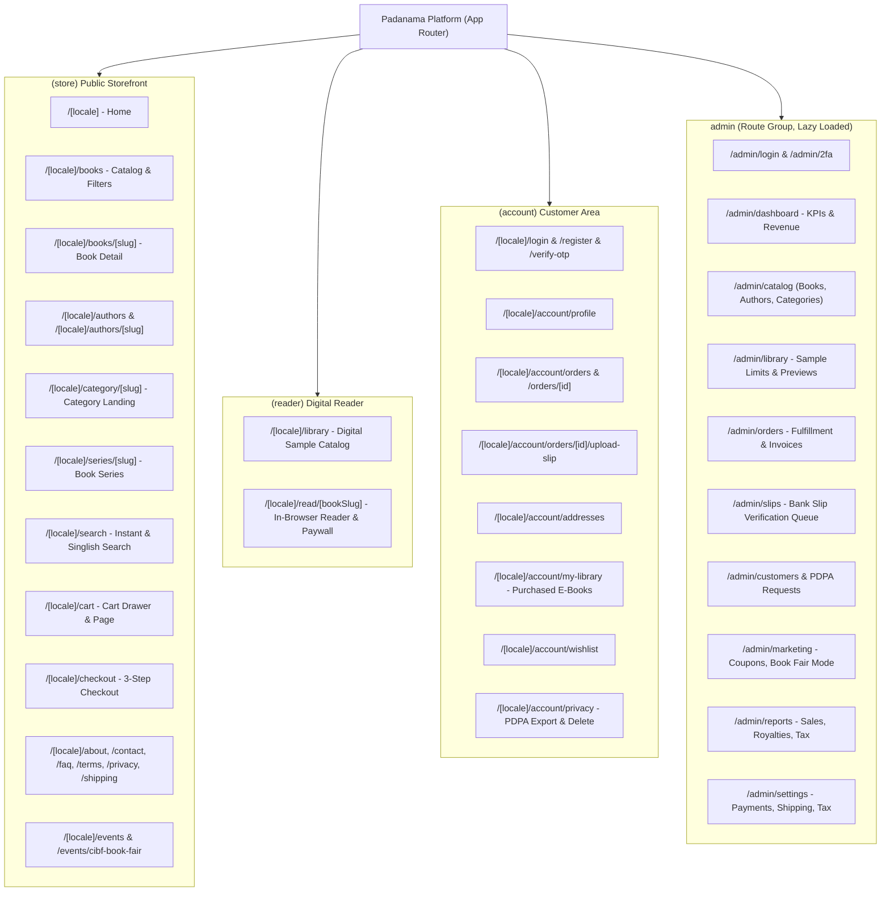

# SITEMAP & INFORMATION ARCHITECTURE

**Document:** `docs/research/sitemap.md`  
**Phase:** Phase 0 (Discovery & Research)  
**Status:** Complete  
**Date:** November 2026  

---

## 1. Information Architecture Overview

The Padanama platform is organized into four distinct route groups within a single Next.js App Router repository, ensuring clean separation of concerns, bundle optimization, and strict role security:

---

## 2. Detailed URL Route Tree & Access Controls

### 2.1. Public Storefront (`src/app/[locale]/(store)/`)

| URL Path | Template / Page | Access Control | Canonical / SEO Notes |
|---|---|---|---|
| `/[locale]` | Homepage (Hero, New Releases, Best Sellers, CIBF Banner, Trust Bar) | Public | Root canonical per locale (`/si`, `/en`, `/ta`) |
| `/[locale]/books` | Master Catalog (Grid/List, Faceted Filters, Sinhala Collation Sort) | Public | Canonical with clean query params (`?category=novels&page=1`) |
| `/[locale]/books/[slug]` | Book Detail Page (Gallery, Specs, Variants, "Read Free Sample", Reviews) | Public | Self-canonical; JSON-LD `Book`, `Product`, `Offer` |
| `/[locale]/category/[slug]` | Category Landing Page (e.g. `scholarship-grade-5`, `sinhala-novels`) | Public | Category description copy for high SEO rank |
| `/[locale]/authors` | Author Directory | Public | Indexable |
| `/[locale]/authors/[slug]` | Author Profile & Bibliography | Public | JSON-LD `Person` schema |
| `/[locale]/series/[slug]` | Book Series / Collection Showcase | Public | Grouped volume listing |
| `/[locale]/search` | Live Search Results (Singlish $\to$ Sinhala, ISBN, Categories) | Public | `noindex` on empty queries; canonicalized search URLs |
| `/[locale]/cart` | Full Shopping Cart (Milestone progress bar, Coupon entry) | Public / Guest | `noindex` |
| `/[locale]/checkout` | 3-Step Mobile-First Checkout (Address, Shipping, Payment) | Public / Guest | `noindex`, SSL enforced |
| `/[locale]/checkout/success` | Order Confirmation Page (Order summary, Bank slip uploader) | Public / Guest | `noindex`, transaction analytics trigger |
| `/[locale]/about` | About Padanama Publications (History, Mission, Editorial Board) | Public | Static ISR |
| `/[locale]/contact` | Contact Page (Google Map, WhatsApp Click-to-Chat, Inquiry Form) | Public | Static ISR |
| `/[locale]/faq` | Frequently Asked Questions (Ordering, Shipping, Bank Transfers) | Public | JSON-LD `FAQPage` schema |
| `/[locale]/shipping-delivery` | Islandwide Shipping Rates (25 Districts, Couriers, SLAs) | Public | Static ISR |
| `/[locale]/returns-refunds` | Return, Replacement & Cancellation Policy | Public | Static ISR |
| `/[locale]/terms` | Terms of Service & Electronic Transactions Agreement | Public | Static ISR |
| `/[locale]/privacy` | Trilingual Privacy Policy (PDPA Act No. 9 of 2022 Compliant) | Public | Static ISR |
| `/[locale]/wholesale` | Institutional & Bookshop Wholesale Quote Request Portal | Public | Form validation with tax ID capture |
| `/[locale]/blog` | Literary & Education Blog (Study guides, Book reviews, News) | Public | Article feed with RSS |
| `/[locale]/blog/[slug]` | Blog Post Detail | Public | JSON-LD `Article` schema |
| `/[locale]/events/cibf` | Colombo International Book Fair Dedicated Campaign Page | Public | Seasonal event hub with countdown |

---

### 2.2. Digital Library & In-Browser Reader (`src/app/[locale]/(reader)/`)

| URL Path | Purpose / Description | Access Control | Content Protection Strategy |
|---|---|---|---|
| `/[locale]/library` | Digital Library Showcase (Browse books offering free preview samples) | Public | Displays sample badge ("Read 20 pages free") |
| `/[locale]/read/[bookSlug]` | **In-Browser Free-Sample & Full E-Book Reader** | Public (Sample) / Entitled (Full) | Serves only server-side sliced preview pages until `Entitlement` is verified; triggers paywall card at sample limit |

---

### 2.3. Customer Account Portal (`src/app/[locale]/(account)/`)

| URL Path | Purpose / Description | Access Control | Features |
|---|---|---|---|
| `/[locale]/login` | Sign In (Email/Password, Google OAuth, SMS OTP) | Unauthenticated | Rate-limited, redirects back to previous page |
| `/[locale]/register` | Sign Up & Welcome | Unauthenticated | Terms and PDPA consent checkboxes |
| `/[locale]/forgot-password` | Password Reset Request & Token Entry | Unauthenticated | Time-limited cryptographically secure tokens |
| `/[locale]/account` | Customer Dashboard Overview | Customer Role | Quick links to recent orders and reading progress |
| `/[locale]/account/orders` | Order History & Real-Time Tracking | Customer Role | Filter by status (`PAID`, `SHIPPED`, `DELIVERED`) |
| `/[locale]/account/orders/[id]` | Order Detail, Invoice PDF & Courier Link | Customer Role / Order Token | Downloadable branded invoice PDF |
| `/[locale]/account/orders/[id]/slip` | Dedicated Bank Transfer Slip Uploader | Customer Role / Order Token | Accepts JPEG/PNG/PDF up to 5MB |
| `/[locale]/account/my-library` | Purchased E-Books Shelf | Customer Role | Quick "Resume Reading" button linking to reader |
| `/[locale]/account/addresses` | Address Book (District dropdowns, landmarks) | Customer Role | Up to 5 saved shipping addresses |
| `/[locale]/account/wishlist` | Saved Favorite Books | Customer Role | Instant "Move to Cart" button |
| `/[locale]/account/privacy` | PDPA Data Subject Privacy Rights Center | Customer Role | One-click JSON data export & deletion request |

---

### 2.4. Unified Admin Console (`src/app/admin/` — Code-Split & Lazy Loaded)

| URL Path | Module | Minimum Role Required | Key Capabilities |
|---|---|---|---|
| `/admin/login` | Administrative Login | Public (Admin credentials) | Brute-force locked, IP logged |
| `/admin/2fa` | Two-Factor Authentication Verification | Pre-auth Admin | TOTP Google Authenticator validation |
| `/admin/dashboard` | Executive KPI Dashboard | `SUPPORT` or higher | Today's revenue, order counts, pending slips, low stock |
| `/admin/catalog/books` | Books List & CRUD | `EDITOR` | Filter by category, language, stock; bulk export |
| `/admin/catalog/books/new` | Create New Book Title & Editions | `EDITOR` | Trilingual fields, cover uploader, variant setup |
| `/admin/catalog/books/[id]` | Edit Book & Manage Variants | `EDITOR` | Adjust pricing, ISBNs, dimensions, stock |
| `/admin/catalog/categories` | Category Management | `EDITOR` | Drag-and-drop hierarchical category tree |
| `/admin/catalog/authors` | Author & Translator Directory | `EDITOR` | Bio, photo, social links, contractual royalty rate |
| `/admin/library/samples` | **Sample Rule Manager** | `LIBRARIAN` | Upload master files, configure sample limits, preview paywall |
| `/admin/orders` | Master Orders Management | `ORDER_MANAGER` | Filter by status, payment method, district |
| `/admin/orders/[id]` | Order Detail & Action Timeline | `ORDER_MANAGER` | Status advance, tracking number input, refund |
| `/admin/orders/slips` | **Bank Slip Verification Queue** | `ACCOUNTANT` | Side-by-side slip viewer, one-click Approve/Reject |
| `/admin/orders/labels` | Bulk Shipping Label & Packing Slips | `ORDER_MANAGER` | Multi-select printable Domex/Koombiyo labels |
| `/admin/inventory` | Inventory Adjustments & Restock | `ORDER_MANAGER` | Stock movement audit trail with reason codes |
| `/admin/customers` | Customer Directory & Segments | `SUPPORT` | View orders, lifetime value, grant/revoke entitlements |
| `/admin/marketing/coupons` | Coupon Code Manager | `MARKETING` | Percentage, fixed discount, min spend, expiration |
| `/admin/marketing/book-fair`| **Book Fair Mode Campaign Center** | `MARKETING` | One-click CIBF banner, 20% discount rules, flash timer |
| `/admin/reports/sales` | Sales & Revenue Reports | `ACCOUNTANT` | Grouped by book, author, category, payment method |
| `/admin/reports/royalties` | **Author Royalty Statement Engine** | `ACCOUNTANT` | Units sold $\times$ royalty %; export statements |
| `/admin/settings/general` | Store Contact & Social Config | `ADMIN` | Phone numbers, WhatsApp, physical address, logo |
| `/admin/settings/shipping` | District Shipping Rates & Zones | `ADMIN` | Edit 25-district rate table, free delivery threshold |
| `/admin/settings/payments` | Payment Gateway Toggles | `ADMIN` | PayHere, WebXPay, Koko, Bank details, COD rules |
| `/admin/settings/tax` | **Dynamic VAT Tax Engine** | `ADMIN` | Global VAT toggle, category overrides, invoice format |
| `/admin/settings/audit-logs`| Immutable System Audit Log Viewer | `SUPER_ADMIN` | Filterable security log of every write action |
| `/admin/settings/users` | Staff Accounts & Role Assignment | `SUPER_ADMIN` | Manage staff logins, roles, and 2FA resets |

---

### 2.5. Backend API & Webhook Endpoints (`src/app/api/`)

| Endpoint Path | Method | Authentication / Guard | Function |
|---|---|---|---|
| `/api/webhooks/payhere` | `POST` | PayHere MD5 Signature Verification | Ingests payment status; verifies `md5sig` & amount; idempotent update |
| `/api/webhooks/webxpay` | `POST` | WebXPay Cryptographic Verification | Fallback payment webhook handler |
| `/api/webhooks/koko` | `POST` | Koko API Secret Header | Ingests BNPL installment approval notifications |
| `/api/reader/[bookSlug]/page`| `GET` | Entitlement / Sample Check | Streams authorized rasterized/encrypted page chunks |
| `/api/search/suggest` | `GET` | Public (Rate-limited) | Returns Singlish transliteration + live title/author suggestions |
| `/api/delivery/calculate` | `POST` | Public (Rate-limited) | Computes dynamic shipping quote based on cart weight & district |
| `/api/feeds/facebook` | `GET` | Public (Cached) | Generates XML product catalog feed for Meta Commerce Manager |
| `/api/feeds/google` | `GET` | Public (Cached) | Generates XML/RSS product feed for Google Merchant Center |
| `/api/health` | `GET` | Public | System health check (PostgreSQL pool, Redis, Sentry) returning 200 OK |
